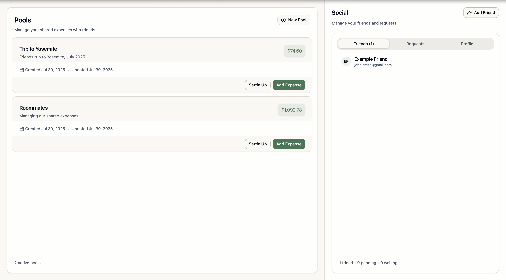
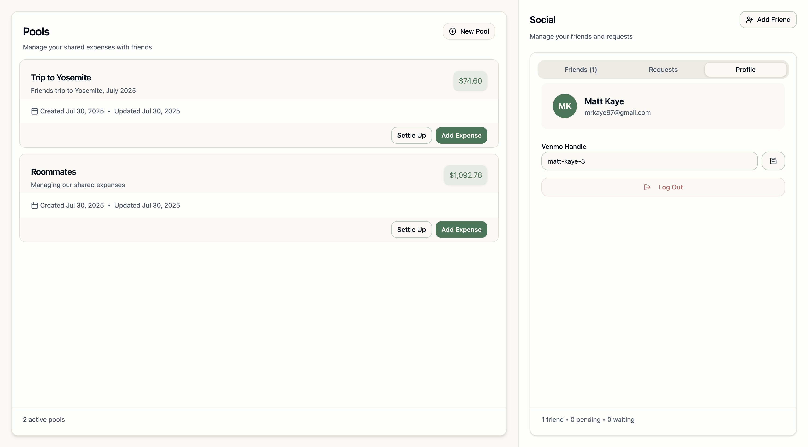
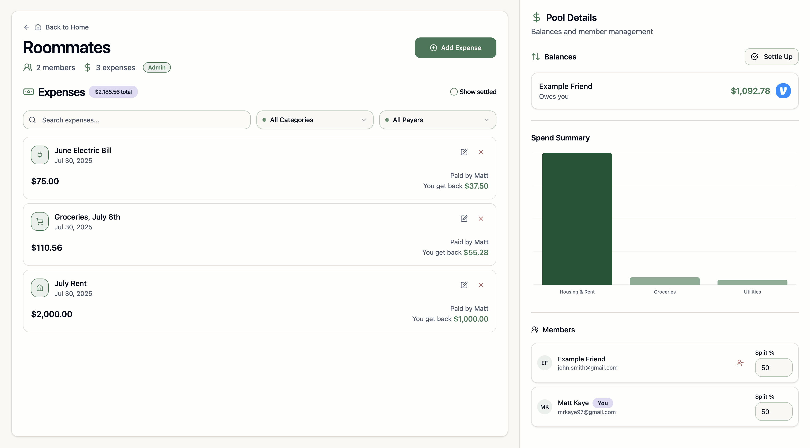
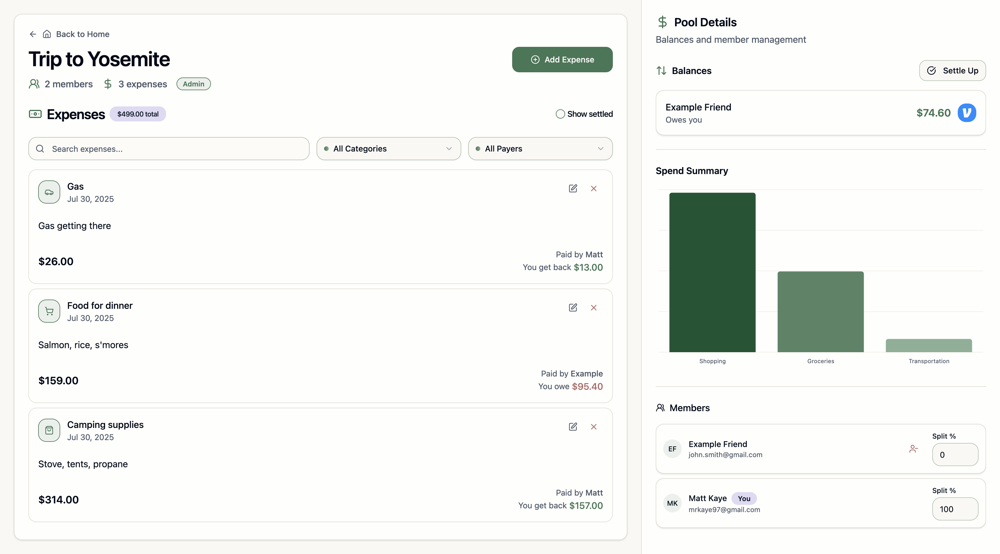
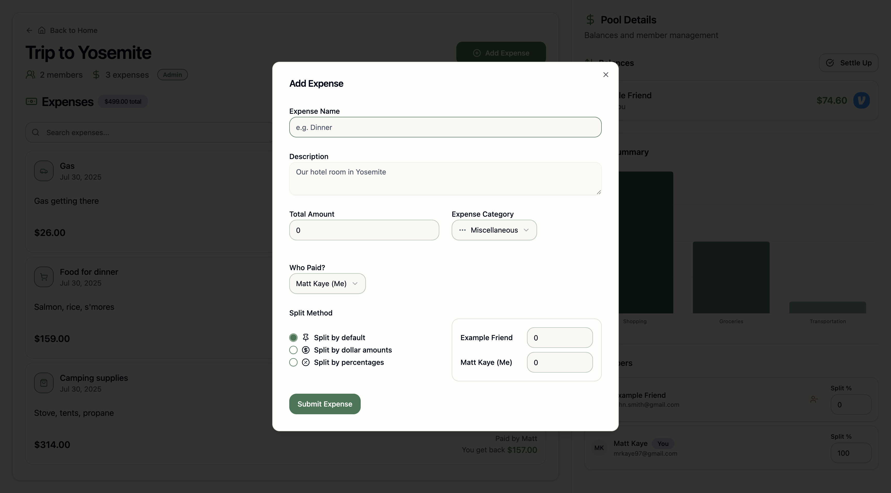

# Medici

Medici is a minimalistic, self-hostable alternative to Splitwise for managing group expenses. Named after the Florentine [House of Medici](https://en.wikipedia.org/wiki/House_of_Medici), it focuses on simplicity and privacy while providing all the essential features you need.

## Why Medici?

- **Privacy-first**: Self-host your financial data instead of trusting third parties
- **Minimalistic**: Clean, distraction-free interface with only essential features
- **Easy deployment**: Single Docker Compose command to get started
- **No subscriptions**: Own your data, no recurring fees
- **Open Source**: Fully transparent codebase, no hidden agendas
- **No tracking**: No ads, analytics, or data collection
- **No limits**: Unlimited pools, friends, and expenses without hidden fees

## Features

### Core Functionality

1. **Pools**: Create groups ("pools") to organize expenses by context (roommates, trips, etc.)
2. **Friend Management**: Add friends and organize them into relevant pools
3. **Smart Splitting**:
   - Set default split percentages per pool for quick expense entry
   - Split expenses evenly or with custom percentages
   - Automatic debt simplification to minimize transactions
4. **Expense Tracking**:
   - Categorize expenses for better organization
   - Add detailed descriptions and notes
   - Track who paid and who owes what

### Analytics & Insights

5. **Spending Analytics**: View top spending categories
6. **Debt Overview**: See who owes you money and how much you owe others at a glance
7. **Payment Integration**: Add Venmo handles for easy payment requests and settlements

### Privacy & Control

8. **Self-hosted**: Keep your financial data on your own infrastructure
9. **Open Source**: Full transparency and customizability
10. **No tracking**: No analytics, ads, or data collection

## Screenshots

### View Pools

|             Friends View              |                   Profile View                    |
| :-----------------------------------: | :-----------------------------------------------: |
|  |  |

### Pool Details

|            Roommates             |            Yosemite Trip             |
| :------------------------------: | :----------------------------------: |
|  |  |

### Add Expenses



## Quick Start

### Docker Compose (Recommended for Self-Hosting)

The easiest way to get Medici running is with Docker Compose:

```bash
curl -O https://raw.githubusercontent.com/mrkaye97/medici/main/compose.example.yaml
docker compose -f compose.example.yaml up
```

Then visit `http://localhost:3000` to get started.

For production, set `AUTH_SECRET_KEY` to a long random value, e.g. from `openssl rand -base64 48`. Anyone who knows it can log in as any user, so don't use the example value, and keep it out of version control.

### Password reset (optional)

Medici can email password reset links over SMTP. Any SMTP service works: Gmail with an [app password](https://myaccount.google.com/apppasswords), Fastmail, Postmark, Resend, Amazon SES, and so on. Set these on the `medici` service:

| Variable         | Example                      | Notes                                              |
| ---------------- | ---------------------------- | -------------------------------------------------- |
| `APP_URL`        | `https://medici.example.com` | Public URL of your Medici; reset links point here  |
| `SMTP_HOST`      | `smtp.gmail.com`             |                                                    |
| `SMTP_PORT`      | `587`                        | `587` for STARTTLS (default) or `465` for TLS      |
| `SMTP_USERNAME`  | `you@gmail.com`              |                                                    |
| `SMTP_PASSWORD`  | app password                 | Keep it in an untracked env file, not in git       |
| `SMTP_FROM`      | `you@gmail.com`              | Optional; defaults to `SMTP_USERNAME`              |
| `SMTP_FROM_NAME` | `Medici`                     | Optional; defaults to `Medici`                     |

"Forgot password?" appears on the login page only when `APP_URL`, `SMTP_HOST`, `SMTP_USERNAME` and `SMTP_PASSWORD` are all set. Links expire after 30 minutes and work once. Using one logs the account out everywhere else.

Without SMTP, you can still create a one-time reset link from the server and send it yourself:

```bash
docker compose exec medici ./server reset-link someone@example.com
```

This needs `APP_URL` set.

### Local Development Setup

For development or if you prefer running without Docker:

**Prerequisites:**

- [Rust](https://rustup.rs/) (latest stable version)
- [Node.js](https://nodejs.org/) (v18 or higher)
- [pnpm](https://pnpm.io/) package manager
- [PostgreSQL](https://postgresql.org/) (v12 or higher)
- [just](https://github.com/casey/just) command runner
- [diesel_cli](https://diesel.rs/guides/getting-started), only if you want to write new migrations (the server applies them itself with `cargo run -- migrate`)

**Detailed Setup Steps:**

1. **Install Prerequisites:**

```bash
# Install Rust
curl --proto '=https' --tlsv1.2 -sSf https://sh.rustup.rs | sh
source ~/.cargo/env

# Install just
cargo install just

# Install Node.js and pnpm (using your preferred method)
# On macOS with Homebrew:
brew install node pnpm
```

2. **Database Setup:**

Run the database with docker compose: `docker compose up -d`

3. **Clone and Configure:**

```bash
# Clone the repository
git clone https://github.com/your-username/medici.git
cd medici

# Set up environment files
just set-env-backend
just set-env-frontend

# Review and edit .env files as needed
cat server/.env
cat frontend/.env
```

4. **Initialize and Start:**

```bash
# Run the complete setup (installs dependencies, runs migrations)
just setup

# Start development servers in separate terminals:

# Terminal 1: Frontend (React dev server)
cd frontend && pnpm dev

# Terminal 2: Backend (Rust server with hot reload)
cd server && cargo watch -x run
```

The development setup will be available at:

- Frontend: `http://localhost:3001`
- Backend API: `http://localhost:8000`

If you pull new migrations, apply them with `cd server && cargo run -- migrate`
(the Docker image does this on start).

#### Demo data

With the backend running, `cd frontend && pnpm seed` fills your local
database with a demo account, eight friends, six pools (with payments, a
settled pool, a hidden pool and an empty one) and category rules. It prints
the demo login when it's done. Each run creates a new, separate set of
accounts. Set `SEED_EMAIL=you@example.com` to also send friend requests to
your own account, and `SEED_API_URL` to point it at a different server.

#### Simulating a slow or flaky server

In development, the frontend can add delay and random failures to every API
call, to check loading and error states. Set it in the browser console (it
takes effect on the next request):

```js
localStorage.setItem("medici:latency", "1500") // ms, ±50% jitter
localStorage.setItem("medici:fail-rate", "0.2") // fail 20% of requests
localStorage.removeItem("medici:latency") // back to normal
```

Or set `VITE_SIMULATED_LATENCY_MS` / `VITE_SIMULATED_FAIL_RATE` in
`frontend/.env.local`. The React Query devtools (bottom-left button in dev)
can also force any single query into its loading or error state. None of
this is included in production builds.
